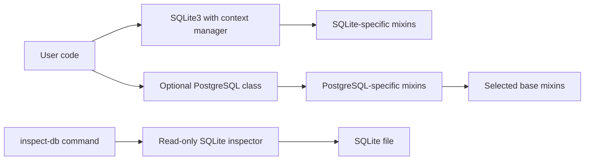

# scitex-db

<p align="center">
  <a href="https://scitex.ai">
    
  </a>
</p>

<p align="center"><b>Database utilities for scientific computing — SQLite3 + PostgreSQL with NumPy-aware storage.</b></p>

<p align="center">
  <a href="https://scitex-db.readthedocs.io/">Full Documentation</a> · <code>uv pip install scitex-db[all]</code>
</p>

<!-- scitex-badges:start -->
<p align="center">
  <a href="https://pypi.org/project/scitex-db/"></a>
  <a href="https://pypi.org/project/scitex-db/"></a>
  <a href="https://github.com/ywatanabe1989/scitex-db/actions/workflows/rtd-sphinx-build-on-ubuntu-latest.yml"></a>
  <a href='https://scitex-db.readthedocs.io/en/latest/'></a>
</p>
<p align="center">
  <a href="https://github.com/ywatanabe1989/scitex-db/actions/workflows/pytest-matrix-on-ubuntu-py3-11-3-12-3-13.yml"></a>
  <a href="https://codecov.io/gh/ywatanabe1989/scitex-db"></a>
  <a href="https://www.gnu.org/licenses/agpl-3.0"></a>
</p>
<!-- scitex-badges:end -->

---

## Problem and Solution

| # | Problem | Solution |
|---|---------|----------|
| 1 | **Numeric arrays need metadata** | SQLite array helpers store binary payloads with dtype, shape, compression and hash columns. |
| 2 | **Connections and transactions need explicit lifecycles** | Use `SQLite3` with a context manager; path-based inspection and duplicate preview are separate helpers. Health limits are stated below. |
| 3 | **Backend ports change contracts** | Backend-specific mixins share some names, but neither a class-name swap nor a matching method proves equivalent behavior. See the [mixin guide](src/scitex_db/_skills/scitex-db/13_mixins.md). |

## Quick Start

The example creates and removes only its own temporary SQLite database. It
verifies persisted rows and an array round trip without a server or repairs.

```python
from pathlib import Path
from tempfile import TemporaryDirectory

import numpy as np
from scitex_db import SQLite3

with TemporaryDirectory() as directory:
    path = Path(directory) / "experiments.db"
    arr = np.arange(2048, dtype=np.float32).reshape(32, 64)
    with SQLite3(str(path), compress_by_default=True) as db:
        db.create_table("results", {
            "id": "INTEGER PRIMARY KEY", "experiment": "TEXT", "accuracy": "REAL",
        })
        db.insert_many("results", [
            {"experiment": "exp1", "accuracy": 0.95},
            {"experiment": "exp2", "accuracy": 0.92},
        ])
        rows = db.get_rows("results", where="accuracy > 0.9", order_by="id")
        assert rows["experiment"].tolist() == ["exp1", "exp2"]
        db.create_table("features", {"id": "INTEGER PRIMARY KEY", "embeddings": "BLOB"})
        db.save_array("features", arr, column="embeddings", additional_columns={"id": 1}, verbose=False)
        features = db.load_array("features", "embeddings", verbose=False)
        assert features.shape == (1, 32, 64) and features.dtype == arr.dtype
        assert np.array_equal(features[0], arr)
    with SQLite3(str(path), mode="ro") as db:
        assert db.get_rows("results", order_by="id")["id"].tolist() == [1, 2]
assert not path.exists()
```

Clean SQLite context exit commits; exceptions roll back and exit closes. Array
loads retain a leading row dimension. See the
[complete quick start](src/scitex_db/_skills/scitex-db/11_quick-start.md) and
[array guide](src/scitex_db/_skills/scitex-db/14_numpy-blob.md).

SQLite3 connections stay in their creating thread. For parallel readers, open
a separate `SQLite3(path, mode="ro")` inside each worker process. See the
[read-only worker guide](src/scitex_db/_skills/scitex-db/17_readonly-workers.md)
for a tested spawn example and the distinction between SQL row selection and
loading complete array BLOBs.

## Inspect an existing SQLite file

Replace the path and table with your own existing file and table. Inspection
opens that SQLite file read-only; it does not create a missing database.

```bash
scitex-db inspect-db /path/to/existing.db --tables results
scitex-db inspect-db /path/to/existing.db --tables results --json
```

For inspection JSON, use `scitex-db inspect-db experiments.db --json`
or `scitex-db --json inspect-db experiments.db`. The output is a list of table
schemas, row counts and up to five sample rows per table; BLOB samples are
size placeholders projected in SQLite without transferring the payload into
Python. This is not a bounded-memory or chunked loader. `--quiet` does not
suppress JSON. Non-finite sample numbers
produce an error instead of invalid JSON. See the
[CLI reference](src/scitex_db/_skills/scitex-db/10_cli-reference.md#scitex-db-inspect-db).
`check-health` is exported, but existing-file scans depend on an undeclared
umbrella loadability provider and may not complete in a core-only install.
The CLI reports a missing provider before scanning; this is a preflight
refusal, not a completed health result. JSON serialization for `check-health`
is unimplemented. Repairs are not demonstrated here; their behavior remains
unqualified. See the [maintenance guide](src/scitex_db/_skills/scitex-db/15_maintenance.md).

## Installation

```bash
uv pip install "scitex-db[all]"
```

<details>
<summary>Per-backend extras</summary>

| Extra | Command | Adds |
|-------|---------|------|
| *(none)* | `uv pip install scitex-db` | SQLite3 backend, NumPy-aware storage, CLI |
| `postgresql` | `uv pip install "scitex-db[postgresql]"` | `psycopg2-binary` + `sqlalchemy` driver |
| `git` | `uv pip install "scitex-db[git]"` | `GitPython` for the db-versioning mixin |
| `all` | `uv pip install "scitex-db[all]"` | everything above, plus dev and docs |

</details>

### Configuration

The current CLI takes database paths and options explicitly on the command
line. YAML configuration and automatic `.env` loading are **not implemented**:
`./config.yaml`, `SCITEX_DB_CONFIG` and `~/.scitex/db/config.yaml` do not select
CLI defaults. Pass options such as `--tables` directly; malformed files at
these locations are ignored, so a successful command does not validate them.

Portable project/user configuration under `.scitex/db` remains an intended
contract awaiting implementation; there is no supported file precedence yet.
See the [CLI skill](src/scitex_db/_skills/scitex-db/04_cli-reference.md#configuration-limit)
and [`.env.example`](./.env.example). Python callers pass constructor/function
arguments explicitly; `store.resolve_store(env=...)` separately reads the
caller-named environment variable, not a package-wide YAML configuration.

## Architecture



<sub><b>Figure 1.</b> Source composition and SQLite helper routing.</sub>

SQLite's mixins do not inherit the base stubs; some PostgreSQL mixins do.
Backend names, arguments, results and transaction behavior need separate
qualification. This diagram does not establish backend parity or completed
health/repair support. See the [mixin guide](src/scitex_db/_skills/scitex-db/13_mixins.md).

## 2 Interfaces

<details open>
<summary><strong>Python API ⭐⭐⭐</strong> &nbsp;<sub>primary surface</sub></summary>

<br>

| SQLite operation | Current entry point |
|---|---|
| Connection lifecycle | `with SQLite3(path) as db` |
| Batch insert / row reads | `db.insert_many(...)` / `db.get_rows(...)` |
| Numeric array storage | `db.save_array(...)` / `db.load_array(table, column, ...)` |
| Explicit transactions | `with db.transaction(): ...` |
| Read-only path inspection | `inspect(path, ...)` returns table dictionaries |
| Duplicate preview | `delete_sqlite3_duplicates(path, table_name, ...)` defaults to preview |

These are SQLite contracts. PostgreSQL requires its optional dependencies and
native server tests; matching names such as `get_rows` do not imply parity.
The [Python API guide](src/scitex_db/_skills/scitex-db/03_python-api.md) and
[mixin guide](src/scitex_db/_skills/scitex-db/13_mixins.md) describe the surfaces.
Generic-object BLOB serialization is outside this numeric example's
qualification. Existing-file health/repair limits are stated above.

</details>

<details>
<summary><strong>CLI ⭐</strong> &nbsp;<sub><code>scitex-db &lt;subcommand&gt;</code></sub></summary>

<br>

```bash
scitex-db --help
scitex-db skills list --json
scitex-db skills get 11_quick-start --json
```

The leaf skills commands expose bundled guidance; the root `SKILL.md` is
retrieved through the owning Dev provider rather than the leaf's sub-skill
lookup. Options and JSON support are command-specific: consult each command's
help. The inspection example above supports JSON; health JSON remains
unimplemented. A root help entry or a successful preflight does not prove that
an operation completed.

</details>

## Behavioral evidence and limits

The quick-start block is a complete disposable fixture, not pseudocode.
Owning implementations are `_sqlite3/_SQLite3.py`, `_SQLite3Mixins/_RowMixin.py`,
`_BatchMixin.py`, `_ArrayMixin.py`, `_inspect.py`, `_skills.py` and `__main__.py`.
Existing leaf controls include `tests/scitex_db/_sqlite3/test__SQLite3.py`,
`test__SQLite3_context_commit.py`, `tests/scitex_db/test___main__.py`,
`test__inspect_readonly.py`, `test__skills.py` and the duplicate-preview tests.
Actual fixture/CLI results are separate from static checks, build success,
public distribution adoption, rendered diagrams or served documentation.

## Array read measurements

For a reproducible resident NumPy / plain SQLite / compressed SQLite baseline,
see the [array-read benchmark](docs/array-read-benchmark.md). It measures the
current whole-BLOB loader; it does not provide chunked time-series reads.

## Part of SciTeX

`scitex-db` is part of [**SciTeX**](https://scitex.ai). The standalone
distribution provides `scitex_db` and the `scitex-db` command; see the
[installation guide](src/scitex_db/_skills/scitex-db/01_installation.md).
Any umbrella facade or forwarding belongs to the separately installed
umbrella distribution. Its availability and behavior are not established by
installing `scitex-db` or by assuming that `scitex.db` is the same module.

>Four Freedoms for Research
>
>0. The freedom to **run** your research anywhere — your machine, your terms.
>1. The freedom to **study** how every step works — from raw data to final manuscript.
>2. The freedom to **redistribute** your workflows, not just your papers.
>3. The freedom to **modify** any module and share improvements with the community.
>
>AGPL-3.0 — because we believe research infrastructure deserves the same freedoms as the software it runs on.

---

<p align="center">
  <a href="https://scitex.ai" target="_blank"></a>
</p>
